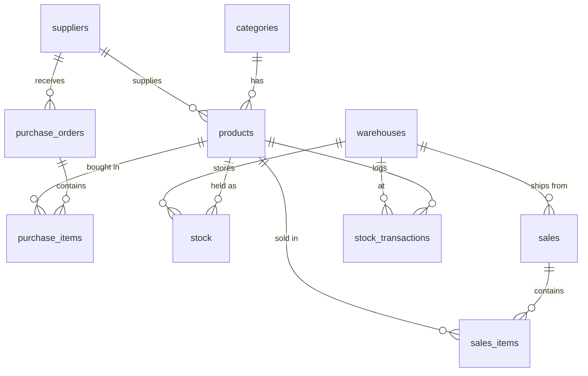

# Inventory Management System - Project Documentation

## Problem Statement
A retail business must track products, suppliers, purchases, sales and available stock across warehouses. Without a central database, stock-outs and over-stocking go unnoticed. This project builds a MySQL database that monitors inventory and raises low-stock alerts.

## Objectives
- Centralise product and supplier data
- Record purchases and sales
- Keep stock accurate per warehouse
- Alert when stock reaches the reorder level
- Produce purchase, sales and stock-movement reports

## Modules
1. Suppliers  2. Product Categories  3. Products  4. Warehouses (plus `stock` table for quantity per warehouse)
5. Purchase Orders  6. Purchase Items  7. Sales  8. Sales Items  9. Stock Transactions

## Functional Requirements
Add/update suppliers, categories and products; raise purchase orders and receive goods; record sales with stock validation; current stock view; low-stock alerts; supplier-wise purchases; monthly sales; fast/slow-moving products.

## How the System Works
A product belongs to one category and one supplier. A purchase order lists products in `purchase_items`; receiving it adds quantity to `stock` and logs an IN row in `stock_transactions` (procedure `sp_receive_po`). A sale lists products in `sales_items`; the trigger `trg_sale_item_ai` reduces stock and logs an OUT row. Views compare stock with `reorder_level` to produce alerts.

## ER Diagram

All relationships are One-to-Many; the products-to-orders many-to-many links are resolved through `purchase_items` and `sales_items`. A drawn version is in `project_website.html` (ER Diagram page).
